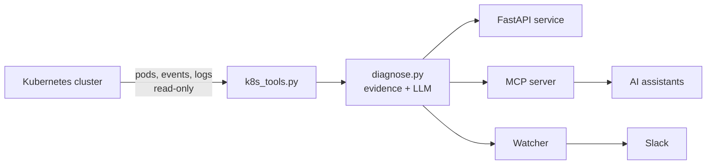

# KubeDoctor

**An AI assistant that finds broken Kubernetes pods and explains the root cause and fix in plain English, then posts it to Slack.**

[Add a demo GIF or video link here]

## What it does

When a pod fails (bad image, crash loop, out of memory, missing config), `kubectl describe` shows about 80 lines where the real cause is buried in two or three. KubeDoctor collects the evidence (pod spec, events, logs), asks an LLM to explain it, and returns a structured diagnosis: root cause, evidence lines, suggested fix and confidence.

Example Slack alert:

> :rotating_light: **crasher** is failing in `default` (CrashLoopBackOff)
> **Cause:** The container exits immediately because the required environment variable DB_URL is missing.
> **Fix:** Add DB_URL to the container's env section, then redeploy the pod.
> **Confidence:** high

## Architecture



- **Evidence collector** (`k8s_tools.py`): lists unhealthy pods and reads their spec, events and logs.
- **Diagnosis** (`diagnose.py`): builds the evidence, calls the LLM (Groq), retries if the JSON reply is malformed.
- **FastAPI service**: `/health`, `/incidents`, `/diagnose/{pod}`.
- **MCP server**: exposes the tools so any MCP-compatible AI assistant can call them.
- **Watcher**: polls every 60 seconds and alerts once per newly failing pod.
- **Deployment**: Docker image, Kubernetes manifests, and a read-only service account.

## Safety by design

KubeDoctor is **read-only**. Its service account can get, list and watch pods, logs and events, and nothing else:

```
kubectl auth can-i list pods   --as=system:serviceaccount:default:kubedoctor   -> yes
kubectl auth can-i delete pods --as=system:serviceaccount:default:kubedoctor   -> no
```

Secrets (API key, Slack webhook) live in a Kubernetes Secret and a git-ignored `.env`, never in the image or the repo.

## Benchmark

10 synthetic failure scenarios, each run until the pod reached a real failure state before diagnosing:

| Scenario | Expected |
|---|---|
| Wrong image tag / unreachable registry / invalid image name | ImagePull |
| Missing environment variable / database unreachable | Config / CrashLoop |
| Memory limit too low | OOMKilled |
| Bad container command | CrashLoop |
| CPU request too large | Scheduling |
| Missing ConfigMap / missing Secret | Config |

A scenario passes only if the category matches **and** the explanation mentions the real cause.

**Results:** [X to Y] out of 10 across [N] runs (model: [your Groq model]).

What improved accuracy: adding the container command to the evidence, putting logs first in the prompt, waiting for real failure states, and retrying on malformed JSON.

## How this differs from k9s and Lens

k9s and Lens show raw Kubernetes data, and you do the interpreting. KubeDoctor reads that data for you and explains it, works from inside the cluster with read-only access, pushes alerts to Slack, and exposes the same tools through MCP so an AI assistant can investigate on your behalf.

## Run it locally (Windows / PowerShell)

Prerequisites: Docker Desktop, kind, kubectl, Python 3.12, a free Groq API key, and optionally a Slack incoming webhook.

```powershell
git clone https://github.com/sukanya-2006/Kubedoctor.git
cd Kubedoctor
python -m venv .venv
.venv\Scripts\Activate.ps1
pip install -r requirements.txt

kind create cluster --name kubedoctor --config kind-config.yaml
kubectl apply -f chaos/            # three deliberately broken pods

copy .env.example .env             # then fill in your keys
python test_diagnose.py            # diagnose the broken pods
python -m kubedoctor.watch         # watch and alert to Slack
```

Deploy into the cluster:

```powershell
docker build -t kubedoctor:0.3 .
kind load docker-image kubedoctor:0.3 --name kubedoctor
kubectl create secret generic kubedoctor-env --from-env-file=.env
kubectl apply -f deploy/
```

Run the benchmark: `python -m benchmark.run_benchmark`

MCP server: `python -m kubedoctor.mcp_server`

## Limitations

- Scenarios are synthetic, not real production incidents.
- A pass means the category and a keyword matched. It does not prove the suggested fix works.
- Pods that are Running but failing readiness probes are not detected yet.
- The free-tier model sometimes drops spaces or returns malformed JSON, which is why retries exist.
- The watcher keeps its "already alerted" list in memory, so a restart re-alerts for pods that are still broken.

## Roadmap

- Detect failing readiness probes and Deployment-level problems
- Store incident history in a database and add a dashboard
- Helm chart and GitHub Actions CI/CD